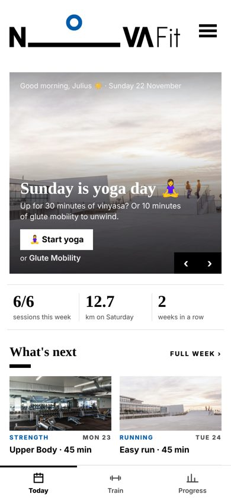
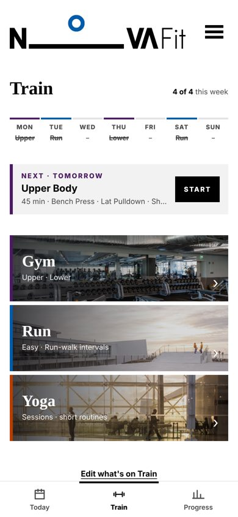
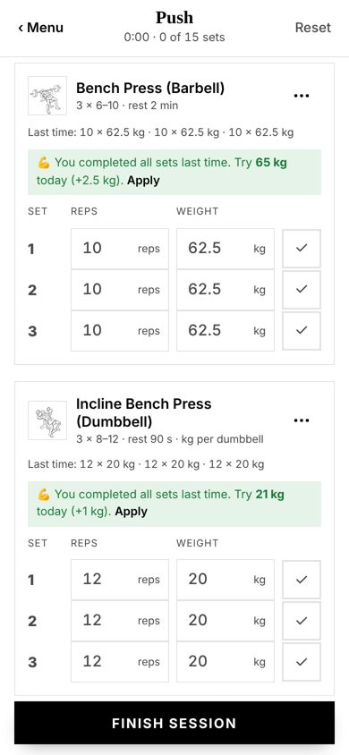
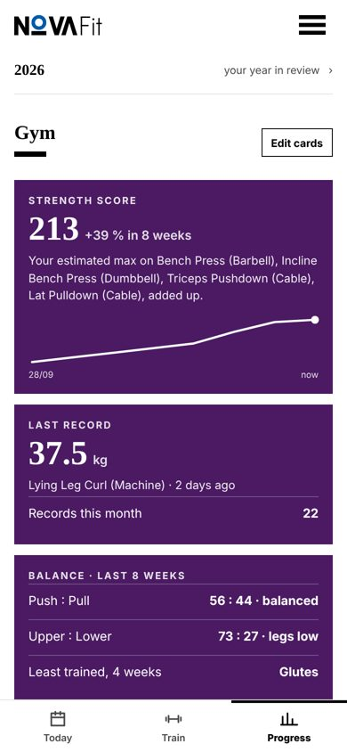

# NOVAFit

**One training app for gym, running and yoga, made for Nova SBE students.**
Group project for *Introduction to Programming* at Nova SBE, 2026/27.

**Live app:** **https://inquisitive-pegasus-dbcd63.netlify.app** · open it on a phone and choose “Add to Home Screen”.

| Today | Train | Workout | Progress |
|---|---|---|---|
|  |  |  |  |

## Team

- Tassilo Mylius
- Dominic Quadflieg
- Julius Veith

## Objectives

**The problem.** Students who want to stay fit next to their studies usually juggle three apps: one for the gym, one for running, one for yoga or stretching. None of them knows about the others, about exam weeks or about the 15 minutes between two lectures.

**What NOVAFit does.** It builds one weekly plan from a short questionnaire (days per week, mix of sports, goals, level) and then helps with every session: what's next today, the weights from last time, runs from a watch screenshot, guided yoga, and progress that shows only the sports you actually do. It looks and feels like Nova SBE.

**What we wanted to learn and show as a programming project:**

1. Build a complete, usable application from scratch in plain HTML, CSS and JavaScript, without a framework.
2. Model real data (plans, sessions, sets, runs, yoga) and keep it safe on the device: validation of every input, a hashed password, no secrets in the code.
3. Keep the logic testable: pure functions in their own files, with unit tests and browser tests that run on every push.
4. Work as a team with Git: every change in its own pull request, a changelog and a version history.
5. Use AI coding assistants responsibly, with us deciding what gets built and reviewing what gets merged (see [How we worked](#how-we-worked)).

## Features

**Getting started**
- Account (name, Nova email, password) and a questionnaire: body data, days per week, mix of gym, running and yoga, goals, level, strength split
- Three suggested week plans; the chosen one sets the weekly goal
- A guided tour right after sign-up that walks through every page (you tap, it explains; optional example data that is removed afterwards). Restart it under *Menu › Guided tour*.

**Today**
- The next session from the plan, one tap to start
- The week ahead, with a heads-up before exams
- Nova SBE news and the last session
- On Sundays the week review, at the start of a month the month review, and a reminder to back up: they take turns with the day's message every 5 seconds

**Train**
- A week line in the colour of each sport and today's session on top
- *Gym:* plan days, own templates, ready-made workouts, 124 exercises with drawings; sets filled in from last time, a suggestion when to add weight, rest timer, guided warm-up, swap or add exercises, records
- *Running:* outdoor or treadmill; read a run from a watch screenshot, import GPX, FIT and TCX files or the whole history from Garmin and Strava; a direct Strava connection is built and tested, but not switched on in our live version, because the Strava API needs a Strava subscription that none of us has (see [docs/setup.md](docs/setup.md#strava-connection)); interval timer; goal plans for 10 km, a half marathon or your own loop
- *Yoga:* 7 guided sessions read aloud, 5-minute study breaks, a tension check before and after, a flexibility check every two weeks
- *Edit what's on Train:* switch sports on or off; everything else follows

**Progress**
- Cards per sport that you pick yourself (strength score, records, balance, race prediction, calm effect and more)
- Weekly, monthly and yearly reviews as stories with your own photos, shareable as an image
- Calendar and full history, 27 badges including special Nova badges

**Make it yours:** own photos, dark mode, push reminders, app lock.

**Four languages:** English, Portuguese, German and Italian. The app starts in the language of the phone; switch with *EN ▾* on the welcome screen or under *Menu › Look and feel › Language*. Exercise names stay in English, like in the gym. Screenshots from running apps are read in English, German, Portuguese, Spanish, French and Italian.

**Your data stays yours:** everything is stored on the phone, not on a server. You create an account once and are never asked to log in again on that phone, unless you lock the app. A backup file saves everything (iCloud Drive, Google Drive, email via the share sheet), the app reminds you every 2 weeks, and *Welcome back › Load backup file* restores it on a new phone.

## Run the application

**Easiest: the live version.** Open the link above on a phone or computer. On a phone choose *Share › Add to Home Screen*: NOVAFit then starts full screen and works offline. On an iPhone, add it to the Home Screen *before* creating the account: Safari and the Home Screen app keep separate data (the app shows how; anyone who signed up in Safari can move everything with *Copy my data* and *Paste from Safari*).

**Locally on your computer** (needs Python 3, nothing to install):

```
git clone https://github.com/juveith/Group-Project---Intro-to-Programming.git
cd Group-Project---Intro-to-Programming
python3 -m http.server 8000 --directory app
```

Then open http://localhost:8000 and create an account. Everything works locally except the parts that need a server function (Strava connection, the news and the running loop).

**On your own phone without Git:** drag the `app` folder onto https://app.netlify.com/drop, open the address it gives you on the phone and add it to the home screen (details in `app/INSTALL.txt`).

**Full setup with Netlify, Strava and push reminders:** see [docs/setup.md](docs/setup.md).

## Run the tests

Needs Node.js 18 or newer:

```
node --test                 # unit tests, no packages needed
npm ci                      # once, installs Playwright (the only package)
npx playwright install chromium
npm run e2e                 # browser tests that drive the real app
```

The unit tests cover sign-up and questionnaire validation, plan suggestions, the exercise library, running files and screenshots, imports, yoga, Progress cards, badges and the tour's example data. The browser tests sign up, log strength sessions, runs and yoga, import files, restore backups and walk through the whole guided tour. GitHub runs both on every push and pull request (`.github/workflows/test.yml`).

## How it's built

Plain HTML, CSS and JavaScript, no build step. The app is a Progressive Web App: it installs from the browser, keeps all data on the phone (`localStorage`) and works offline through a service worker. Three small Netlify Functions keep the Strava secret, the routing key and the news feed off the phone.

| Path | What it is |
|---|---|
| `app/index.html`, `app/app.js` | The page with its design, and the app itself (screens, sessions, storage) |
| `app/plan.js`, `exercises.js`, `run.js`, `yoga.js`, `muscles.js`, `progress.js`, `tour.js` | The logic as pure, tested functions: plans, exercise library, running, yoga, muscles, Progress and badges, tour data |
| `app/guide.js` | The guided tour |
| `netlify/functions/` | Strava, the running loop and the news (server side) |
| `tests/`, `e2e/` | Unit tests and browser tests |
| `docs/` | Setup, architecture and security notes |

More detail: [docs/architecture.md](docs/architecture.md) · [docs/security.md](docs/security.md) · notes for new team members and coding agents in [AGENTS.md](AGENTS.md).

## How we worked

Every change went through its own branch and pull request into `main`, with a short description and an entry in [CHANGELOG.md](CHANGELOG.md). The tests run on every pull request. All of them are listed under [Pull requests](https://github.com/juveith/Group-Project---Intro-to-Programming/pulls?q=is%3Apr).

**Who did what** (pull requests as listed on GitHub; we discussed and tested together):

- **Julius Veith:** the first version of the app and the Nova redesign (v1.0, v2.0), the English app with sign-up, questionnaire and personal plans, goals and body data, the exercise library with 124 drawings, strength splits and mobility add-ons
- **Tassilo Mylius:** running: screenshots, GPX/FIT/TCX files, the Strava connection, importing a training history from Garmin and Strava, runs near you; yoga goals and the flexibility check; security headers and protected functions; the browser tests
- **Dominic Quadflieg:** the Nova design system, header, photo pack and icon; calories; build-your-own plans; the workout page; weather; yoga sessions with voice and the tension check; the Today · Train · Progress layout, Nova news, sport pages, reviews by sport, Progress cards, badges and the guided tour

**Use of AI.** We used AI coding assistants throughout, mainly Claude (Anthropic) through Claude Code, as encouraged in the course. We decided what to build, described features and designs, reviewed the results on real phones, asked for changes and merged each pull request ourselves. Commits written by the assistant are marked with the author “Claude” or a `Co-Authored-By: Claude` line, so the history shows which code was generated. The tests were part of every change, so generated code had to pass the same checks as our own.

## Version history

| Version | Date | Milestone |
|---|---|---|
| v1.0 | 10 Nov 2026 | First version of the app ([#1](https://github.com/juveith/Group-Project---Intro-to-Programming/pull/1), kept on purpose, not merged) |
| v2.0–v2.2 | 10–11 Nov | NOVAFit in the Nova SBE design ([#2](https://github.com/juveith/Group-Project---Intro-to-Programming/pull/2), [#3](https://github.com/juveith/Group-Project---Intro-to-Programming/pull/3)) |
| v2.3–v2.4 | 17 Nov | Account, questionnaire and personal plans ([#4](https://github.com/juveith/Group-Project---Intro-to-Programming/pull/4), [#5](https://github.com/juveith/Group-Project---Intro-to-Programming/pull/5)) |
| v2.5–v2.7 | 17 Nov | Runs from screenshots, files and Strava ([#6](https://github.com/juveith/Group-Project---Intro-to-Programming/pull/6)–[#9](https://github.com/juveith/Group-Project---Intro-to-Programming/pull/9)) |
| v2.8–v2.10 | 17–18 Nov | Exercise library with drawings, training history import ([#12](https://github.com/juveith/Group-Project---Intro-to-Programming/pull/12)–[#17](https://github.com/juveith/Group-Project---Intro-to-Programming/pull/17)) |
| | 17–18 Nov | Yoga, weather, workout page, Today · Train · Progress layout ([#19](https://github.com/juveith/Group-Project---Intro-to-Programming/pull/19)–[#30](https://github.com/juveith/Group-Project---Intro-to-Programming/pull/30)) |
| v2.11–v2.14 | 19 Nov | Runs near you, yoga goals, security, browser tests ([#32](https://github.com/juveith/Group-Project---Intro-to-Programming/pull/32)–[#36](https://github.com/juveith/Group-Project---Intro-to-Programming/pull/36)) |
| | 21 Nov | Nova news, new Train with sport pages, reviews by sport, Progress per sport, badges, guided tour ([#37](https://github.com/juveith/Group-Project---Intro-to-Programming/pull/37)–[#52](https://github.com/juveith/Group-Project---Intro-to-Programming/pull/52)) |

Every change in detail: [CHANGELOG.md](CHANGELOG.md).

## Credits

- Exercise drawings in `app/img/ex/` from [Everkinetic](https://github.com/everkinetic/data) and [Workout Guide](https://github.com/bryllim/workout-guide) by Bryl Lim, licensed [CC BY-SA 4.0](https://creativecommons.org/licenses/by-sa/4.0/) (list in `app/img/ex/SOURCES.md`).
- Photos in `app/img/pack/` © Nova SBE, used only for this course project.
- Text recognition for run screenshots: [Tesseract.js](https://github.com/naptha/tesseract.js) 5.1.1. Push reminders: OneSignal.
